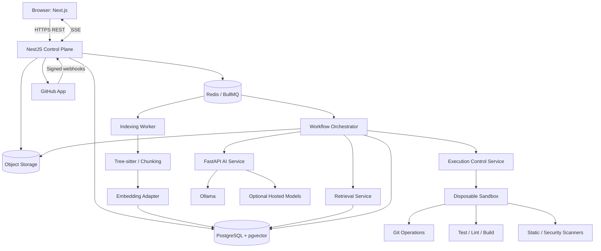

# ANVAYA — System Architecture

**Document type:** Canonical system architecture  
**Architecture style:** Modular control-plane application, asynchronous workers, dedicated AI service, isolated execution plane

## 1. Architecture objectives

Anvaya must:
- Understand repositories without loading entire codebases into model context.
- Separate product/business logic from AI inference.
- Execute untrusted repository code outside the application control plane.
- Support local and hosted model providers without provider lock-in.
- Preserve durable workflow state and evidence.
- Scale web/API, indexing, orchestration, and execution independently.
- Be operable locally on modest hardware during development.

## 2. Architecture principles

1. Modular monolith for the primary application API.
2. Separate AI service because of Python ecosystem and model/provider concerns.
3. Separate indexing and orchestration workers for asynchronous workloads.
4. Separate execution plane as a security boundary.
5. PostgreSQL is the source of truth; Redis is not.
6. All model calls pass through a provider adapter and budget policy.
7. All tools are narrow, typed, and permission-scoped.
8. No arbitrary shell execution from an LLM.
9. External side effects are idempotent and approval-gated.
10. Local-first inference with no silent paid fallback.

## 3. Logical architecture

## 4. Service responsibilities

### 4.1 Web client — Next.js
Owns:
- User interface and navigation.
- Repository explorer and knowledge views.
- Task creation and plan approval.
- Run timeline and SSE display.
- Diff, test, review, and PR review surfaces.
- Workspace and provider settings.

Does not own:
- Authorization decisions.
- Secret storage.
- Model API calls.
- GitHub private credentials.
- Shell execution.

### 4.2 Application API — NestJS
Modules:
- Identity and sessions.
- Workspace and membership.
- Git provider integration.
- Repository metadata and indexing commands.
- Task and run lifecycle.
- Approval and review records.
- Usage and quotas.
- Audit and event delivery.
- Provider policy and configuration.

The API is the control plane. It validates user intent, enforces authorization, persists state, and dispatches jobs. It must not run repository code or wait synchronously for long model operations.

### 4.3 AI service — FastAPI
Owns:
- Provider adapters.
- Prompt templates and versioning.
- Structured output schemas.
- Generation and embedding requests.
- Context/token budget checks.
- Provider health and rate-limit normalization.
- Redaction before logging.
- Model evaluation utilities.

Does not own:
- User authorization.
- GitHub write operations.
- Direct database administration.
- Arbitrary filesystem or shell access.

### 4.4 Indexing worker
Owns:
- Repository snapshot retrieval.
- File classification and exclusions.
- Language detection.
- Tree-sitter parsing.
- Symbol and relationship extraction.
- Chunking and line mapping.
- Embedding generation.
- Incremental indexing and invalidation.

### 4.5 Workflow orchestrator
Owns:
- Durable task state machine.
- Context retrieval coordination.
- Analyst/planner/developer/reviewer stage sequencing.
- Checkpoint persistence.
- Approval waits.
- Budget and retry enforcement.
- Cancellation and recovery.
- Dispatching execution jobs.

Use LangGraph if its checkpointing and state semantics fit the implementation; otherwise a persisted explicit state machine is acceptable. The product contract is the workflow behavior, not a framework dependency.

### 4.6 Execution control service
Owns:
- Creating disposable execution environments.
- Applying validated patches.
- Running predefined command profiles.
- Enforcing resource/network policy.
- Collecting logs and artifacts.
- Terminating and cleaning up environments.

It should have a separate identity and network boundary from the API and AI service.

### 4.7 Data layer
- PostgreSQL: users, workspaces, repositories, index metadata, tasks, runs, approvals, results, audit.
- pgvector: code/document embeddings.
- Redis: queue, short-lived locks, cache, event fan-out.
- Object storage: repository archives, patch files, large logs, test artifacts.
- Optional search index: only if PostgreSQL retrieval no longer meets measured needs.

## 5. Core data flows

### 5.1 Repository onboarding
1. User authorizes GitHub App installation.
2. API records installation and repository selection.
3. API creates indexing job and returns `202 Accepted`.
4. Indexing worker obtains short-lived installation token.
5. Worker fetches repository snapshot at a specific commit SHA.
6. File classifier applies exclusions, size limits, and secret detection.
7. Tree-sitter parses supported source files.
8. Chunker produces line-aware chunks and symbol metadata.
9. Embedding adapter creates vectors.
10. Worker writes index records and marks coverage/status.
11. UI displays indexed commit, language coverage, excluded files, and errors.

### 5.2 Repository question
1. API checks workspace and repository access.
2. Retrieval performs lexical and vector search.
3. Results are filtered by repository, branch/commit, path, language, and access policy.
4. Reranker selects a bounded evidence pack.
5. AI service generates an answer with source citations.
6. API returns answer, citations, model/provider, and limitations.
7. UI opens source at the indexed commit and line range.

### 5.3 Engineering task
1. API creates task and durable run.
2. Orchestrator validates access and budgets.
3. Retrieval creates context pack.
4. Analyst identifies evidence and gaps.
5. Planner creates structured plan.
6. User approves or rejects plan.
7. Execution service creates isolated workspace.
8. Developer proposes patch within approved scope.
9. Patch validator checks paths, file count, size, and format.
10. Sandbox applies patch and runs command profiles.
11. Optional bounded repair stage consumes remaining budget.
12. Reviewer inspects actual diff and verification evidence.
13. Security policy checks run.
14. User approves PR creation.
15. Git provider adapter creates branch/commit/PR.
16. Run is finalized with artifacts, audit, and usage records.

## 6. Workflow state machine

Normal states:
`queued → retrieving_context → investigating → planning → awaiting_plan_approval → preparing_workspace → implementing → verifying → reviewing → awaiting_pr_approval → creating_pr → completed`

Terminal states:
`failed`, `cancelled`, `timed_out`, `rejected`, `completed_without_pr`.

Rules:
- State transitions are centrally validated.
- State changes are persisted transactionally.
- A terminal state cannot return to active.
- PR creation is only valid after an authorized approval.
- Cancellation prevents new model/tool actions and signals worker termination.
- Every transition records actor, timestamp, run version, and reason.
- Use optimistic concurrency or row locking to prevent duplicate transitions.

## 7. Model-provider architecture

Provider interface:
- `generate(request, budget) -> GenerationResult`
- `generate_structured(request, schema, budget) -> ValidatedResult`
- `embed(texts, model) -> EmbeddingResult`
- `health() -> ProviderHealth`
- `capabilities() -> ProviderCapabilities`

Adapters:
- Ollama local.
- Hosted providers, enabled only by policy and user/workspace consent.
- Mock provider for tests and dry runs.

Routing policy:
1. Resolve workspace provider policy.
2. Resolve user-selected local/cloud mode.
3. Check provider availability and quota.
4. Apply model/context/output budget.
5. Record provider and data classification.
6. If unavailable, pause/fail with a clear reason.
7. Never silently route to paid inference.

## 8. Repository intelligence architecture

Pipeline:
`Snapshot → File classification → Parser → Symbol extraction → Chunker → Embeddings → Lexical index → Relationship index → Retrieval`

Index records must be versioned by:
- Repository ID.
- Commit SHA.
- File path and blob/content hash.
- Parser version.
- Chunker version.
- Embedding model/version.

Retrieval:
- PostgreSQL full-text search.
- pgvector similarity.
- Metadata and permission filters.
- Deterministic merge/deduplication.
- Optional reranker.
- Evidence pack with citations and token estimate.

The architecture must allow re-embedding or reparsing without losing repository identity or task history.

## 9. Execution-plane architecture

Execution requests contain:
- Run ID and tenant scope.
- Immutable repository snapshot reference.
- Approved patch reference.
- Command profile IDs.
- Resource/time/output limits.
- Network policy.
- Artifact destination and scoped upload credential.

Execution environment:
- Disposable per run.
- Non-root.
- No privileged mode.
- No Docker socket.
- No application secrets.
- No database/Redis access.
- Read-only root filesystem where feasible.
- Dedicated writable workspace.
- CPU, memory, PID, disk, wall-time, and output limits.
- Network egress denied by default.
- Restricted capabilities and syscall profile.
- Logs and artifacts bounded and redacted.

For untrusted public repositories in a multi-tenant production product, hardened containers alone are insufficient. Use microVMs or a specialized sandbox service and conduct an independent security review.

## 10. Event and messaging model

Queues:
- `repository-index`
- `repository-reindex`
- `engineering-run`
- `sandbox-execution`
- `artifact-cleanup`
- `webhook-processing`

Events:
- `repository.index.started`
- `repository.index.completed`
- `run.status.changed`
- `run.stage.changed`
- `agent.started`
- `agent.completed`
- `tool.started`
- `tool.completed`
- `verification.completed`
- `approval.required`
- `pull_request.created`
- `run.failed`
- `run.cancelled`

Use an outbox pattern for events that must be reliably published after database commits. Redis is transport, not durable truth.

## 11. Deployment architecture

### Local development
- Next.js dev server.
- NestJS API.
- FastAPI AI service.
- PostgreSQL + pgvector.
- Redis.
- Indexing and orchestration workers.
- Local Ollama on host.
- Docker-based execution worker.
- Optional MinIO for S3-compatible artifacts.

### Production reference architecture
- Next.js hosted frontend or container.
- NestJS API on ECS or equivalent.
- FastAPI AI service on separate compute.
- Separate indexing and orchestration worker pools.
- RDS PostgreSQL.
- ElastiCache Redis.
- S3 artifacts.
- Secrets Manager.
- OpenTelemetry collector and CloudWatch/Grafana.
- Execution plane isolated in separate account/VPC or managed microVM service.
- WAF, ALB, TLS, private subnets, restricted egress.

## 12. Architecture decisions

- Primary API: NestJS modular monolith.
- AI service: FastAPI.
- Orchestration: persisted workflow state machine; LangGraph implementation where appropriate.
- Primary database: PostgreSQL.
- Vector retrieval: pgvector initially.
- Queue: Redis/BullMQ, backed by durable database state.
- Model runtime: Ollama-first, provider-independent.
- Execution: isolated worker plane.
- Git provider: GitHub App first.
- Approval: human approval before PR creation.
- Deployment: local-first development, AWS reference production topology.

## 13. Scaling strategy

Scale in this order:
1. Optimize retrieval and indexing.
2. Separate queue worker pools.
3. Add per-workspace concurrency and rate limits.
4. Scale stateless API instances.
5. Scale embedding/indexing workers independently.
6. Scale sandbox capacity with hard tenant quotas.
7. Introduce dedicated search infrastructure only when benchmarks justify it.
8. Introduce service decomposition only when independent scaling, ownership, or reliability requires it.
