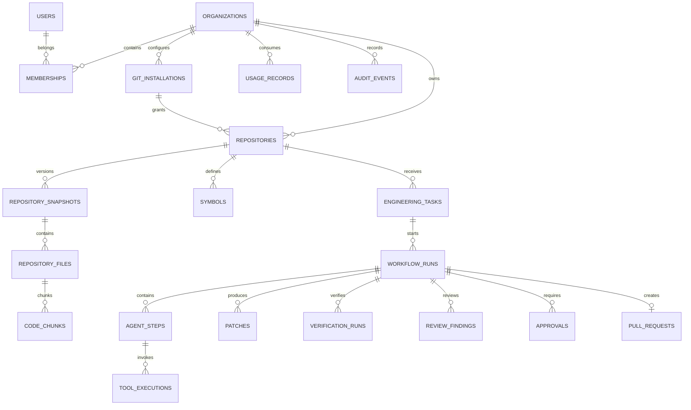

# ANVAYA — Data Model and Database Specification

**Primary database:** PostgreSQL  
**Vector extension:** pgvector  
**ID strategy:** UUID  
**Time standard:** UTC (`timestamptz`)  
**Document type:** Canonical data model

## 1. Data design principles

- PostgreSQL is the source of truth for business and workflow state.
- Redis is ephemeral infrastructure and is never the only copy of important state.
- Every tenant-owned record is scoped to a workspace directly or through a verified parent.
- All references use foreign keys where practical.
- Use explicit migrations; never production schema auto-sync.
- Store large source snapshots, diffs, logs, and artifacts in object storage.
- Store only metadata, hashes, and object keys in relational tables.
- Never persist raw secrets or unredacted environment variables.
- Every indexed item retains source provenance and version.
- Embeddings are tied to model name, model version, and dimension.

## 2. Domain model

Primary domains:
1. Identity and tenancy.
2. Git integrations.
3. Repository and index.
4. Engineering knowledge.
5. Tasks and workflow runs.
6. Agent steps and tool traces.
7. Changes and verification.
8. Reviews and approvals.
9. Pull requests.
10. Usage and audit.

## 3. Entity relationships



## 4. Core schema

The SQL below is the canonical logical starting point. Production migrations may split or normalize fields further. Confirm the actual embedding dimension of the chosen model before applying the vector column definition.

```sql
CREATE EXTENSION IF NOT EXISTS pgcrypto;
CREATE EXTENSION IF NOT EXISTS vector;

CREATE TABLE users (
  id uuid PRIMARY KEY DEFAULT gen_random_uuid(),
  auth_subject text UNIQUE NOT NULL,
  email text UNIQUE NOT NULL,
  display_name text,
  avatar_url text,
  created_at timestamptz NOT NULL DEFAULT now(),
  updated_at timestamptz NOT NULL DEFAULT now()
);

CREATE TABLE organizations (
  id uuid PRIMARY KEY DEFAULT gen_random_uuid(),
  name text NOT NULL,
  slug text UNIQUE NOT NULL,
  created_by uuid REFERENCES users(id),
  plan_key text NOT NULL DEFAULT 'personal',
  settings jsonb NOT NULL DEFAULT '{}'::jsonb,
  created_at timestamptz NOT NULL DEFAULT now(),
  updated_at timestamptz NOT NULL DEFAULT now()
);

CREATE TABLE memberships (
  organization_id uuid NOT NULL REFERENCES organizations(id) ON DELETE CASCADE,
  user_id uuid NOT NULL REFERENCES users(id) ON DELETE CASCADE,
  role text NOT NULL CHECK (role IN ('owner','admin','member','viewer')),
  created_at timestamptz NOT NULL DEFAULT now(),
  PRIMARY KEY (organization_id, user_id)
);

CREATE TABLE git_installations (
  id uuid PRIMARY KEY DEFAULT gen_random_uuid(),
  organization_id uuid NOT NULL REFERENCES organizations(id) ON DELETE CASCADE,
  provider text NOT NULL CHECK (provider IN ('github')),
  external_installation_id bigint NOT NULL UNIQUE,
  account_login text NOT NULL,
  account_type text,
  granted_permissions jsonb NOT NULL DEFAULT '{}'::jsonb,
  status text NOT NULL DEFAULT 'active'
    CHECK (status IN ('active','suspended','disconnected')),
  created_at timestamptz NOT NULL DEFAULT now(),
  updated_at timestamptz NOT NULL DEFAULT now()
);

CREATE TABLE repositories (
  id uuid PRIMARY KEY DEFAULT gen_random_uuid(),
  organization_id uuid NOT NULL REFERENCES organizations(id) ON DELETE CASCADE,
  installation_id uuid REFERENCES git_installations(id) ON DELETE SET NULL,
  provider text NOT NULL DEFAULT 'github',
  external_repository_id bigint NOT NULL UNIQUE,
  owner text NOT NULL,
  name text NOT NULL,
  full_name text NOT NULL,
  default_branch text,
  visibility text CHECK (visibility IN ('public','private','internal')),
  status text NOT NULL DEFAULT 'connected'
    CHECK (status IN ('connected','disabled','disconnected')),
  indexing_status text NOT NULL DEFAULT 'pending'
    CHECK (indexing_status IN ('pending','queued','indexing','ready','partial','failed','disabled')),
  latest_indexed_commit_sha text,
  indexed_at timestamptz,
  settings jsonb NOT NULL DEFAULT '{}'::jsonb,
  created_at timestamptz NOT NULL DEFAULT now(),
  updated_at timestamptz NOT NULL DEFAULT now(),
  UNIQUE (organization_id, full_name)
);

CREATE TABLE repository_snapshots (
  id uuid PRIMARY KEY DEFAULT gen_random_uuid(),
  repository_id uuid NOT NULL REFERENCES repositories(id) ON DELETE CASCADE,
  commit_sha text NOT NULL,
  branch_name text,
  archive_object_key text,
  archive_hash text,
  total_files integer NOT NULL DEFAULT 0,
  indexed_files integer NOT NULL DEFAULT 0,
  excluded_files integer NOT NULL DEFAULT 0,
  status text NOT NULL CHECK (status IN ('queued','processing','ready','partial','failed')),
  parser_version text,
  chunker_version text,
  created_at timestamptz NOT NULL DEFAULT now(),
  UNIQUE (repository_id, commit_sha)
);

CREATE TABLE repository_files (
  id uuid PRIMARY KEY DEFAULT gen_random_uuid(),
  snapshot_id uuid NOT NULL REFERENCES repository_snapshots(id) ON DELETE CASCADE,
  repository_id uuid NOT NULL REFERENCES repositories(id) ON DELETE CASCADE,
  path text NOT NULL,
  blob_sha text,
  content_hash text NOT NULL,
  language text,
  file_type text,
  byte_size bigint NOT NULL CHECK (byte_size >= 0),
  line_count integer,
  is_excluded boolean NOT NULL DEFAULT false,
  exclusion_reason text,
  created_at timestamptz NOT NULL DEFAULT now(),
  UNIQUE (snapshot_id, path)
);

CREATE TABLE code_chunks (
  id uuid PRIMARY KEY DEFAULT gen_random_uuid(),
  repository_file_id uuid NOT NULL REFERENCES repository_files(id) ON DELETE CASCADE,
  chunk_index integer NOT NULL,
  start_line integer NOT NULL,
  end_line integer NOT NULL,
  symbol_name text,
  chunk_kind text,
  content text NOT NULL,
  embedding vector(768),
  embedding_model text NOT NULL,
  embedding_version text NOT NULL,
  created_at timestamptz NOT NULL DEFAULT now(),
  CHECK (start_line > 0 AND end_line >= start_line),
  UNIQUE (repository_file_id, chunk_index)
);

CREATE TABLE symbols (
  id uuid PRIMARY KEY DEFAULT gen_random_uuid(),
  repository_id uuid NOT NULL REFERENCES repositories(id) ON DELETE CASCADE,
  snapshot_id uuid NOT NULL REFERENCES repository_snapshots(id) ON DELETE CASCADE,
  repository_file_id uuid NOT NULL REFERENCES repository_files(id) ON DELETE CASCADE,
  symbol_key text NOT NULL,
  name text NOT NULL,
  qualified_name text,
  kind text NOT NULL,
  start_line integer NOT NULL,
  end_line integer NOT NULL,
  language text,
  signature text,
  created_at timestamptz NOT NULL DEFAULT now(),
  UNIQUE (snapshot_id, symbol_key)
);

CREATE TABLE symbol_relationships (
  id uuid PRIMARY KEY DEFAULT gen_random_uuid(),
  snapshot_id uuid NOT NULL REFERENCES repository_snapshots(id) ON DELETE CASCADE,
  source_symbol_id uuid NOT NULL REFERENCES symbols(id) ON DELETE CASCADE,
  target_symbol_id uuid REFERENCES symbols(id) ON DELETE SET NULL,
  relationship_type text NOT NULL,
  target_external_name text,
  evidence jsonb NOT NULL DEFAULT '{}'::jsonb,
  created_at timestamptz NOT NULL DEFAULT now()
);

CREATE TABLE knowledge_documents (
  id uuid PRIMARY KEY DEFAULT gen_random_uuid(),
  organization_id uuid NOT NULL REFERENCES organizations(id) ON DELETE CASCADE,
  repository_id uuid REFERENCES repositories(id) ON DELETE CASCADE,
  source_type text NOT NULL CHECK (source_type IN ('readme','architecture','decision','issue','pull_request','engineering_note')),
  external_id text,
  title text NOT NULL,
  content_object_key text,
  content_hash text NOT NULL,
  source_url text,
  indexed_at timestamptz,
  created_at timestamptz NOT NULL DEFAULT now()
);

CREATE TABLE engineering_tasks (
  id uuid PRIMARY KEY DEFAULT gen_random_uuid(),
  organization_id uuid NOT NULL REFERENCES organizations(id) ON DELETE CASCADE,
  repository_id uuid NOT NULL REFERENCES repositories(id) ON DELETE CASCADE,
  created_by uuid NOT NULL REFERENCES users(id),
  source_type text NOT NULL CHECK (source_type IN ('github_issue','pull_request','failing_check','manual')),
  external_number integer,
  title text NOT NULL,
  description text NOT NULL,
  status text NOT NULL DEFAULT 'open'
    CHECK (status IN ('open','active','completed','failed','cancelled','archived')),
  labels jsonb NOT NULL DEFAULT '[]'::jsonb,
  created_at timestamptz NOT NULL DEFAULT now(),
  updated_at timestamptz NOT NULL DEFAULT now()
);

CREATE TABLE workflow_runs (
  id uuid PRIMARY KEY DEFAULT gen_random_uuid(),
  organization_id uuid NOT NULL REFERENCES organizations(id) ON DELETE CASCADE,
  task_id uuid NOT NULL REFERENCES engineering_tasks(id) ON DELETE CASCADE,
  run_number integer NOT NULL,
  status text NOT NULL,
  current_stage text,
  provider text,
  model text,
  mode text NOT NULL DEFAULT 'local' CHECK (mode IN ('local','cloud','mock')),
  state_version integer NOT NULL DEFAULT 1,
  budget jsonb NOT NULL DEFAULT '{}'::jsonb,
  usage_summary jsonb NOT NULL DEFAULT '{}'::jsonb,
  started_at timestamptz,
  ended_at timestamptz,
  error_code text,
  error_summary text,
  created_at timestamptz NOT NULL DEFAULT now(),
  updated_at timestamptz NOT NULL DEFAULT now(),
  UNIQUE (task_id, run_number)
);

CREATE TABLE agent_steps (
  id uuid PRIMARY KEY DEFAULT gen_random_uuid(),
  run_id uuid NOT NULL REFERENCES workflow_runs(id) ON DELETE CASCADE,
  sequence_number integer NOT NULL,
  agent_type text NOT NULL,
  status text NOT NULL CHECK (status IN ('queued','running','succeeded','failed','skipped','cancelled')),
  prompt_version text,
  input_redacted jsonb,
  output_redacted jsonb,
  provider text,
  model text,
  input_tokens integer,
  output_tokens integer,
  duration_ms bigint,
  started_at timestamptz,
  ended_at timestamptz,
  error_code text,
  created_at timestamptz NOT NULL DEFAULT now(),
  UNIQUE (run_id, sequence_number)
);

CREATE TABLE tool_executions (
  id uuid PRIMARY KEY DEFAULT gen_random_uuid(),
  agent_step_id uuid NOT NULL REFERENCES agent_steps(id) ON DELETE CASCADE,
  tool_name text NOT NULL,
  status text NOT NULL CHECK (status IN ('started','succeeded','failed','cancelled')),
  input_redacted jsonb,
  output_redacted jsonb,
  duration_ms bigint,
  created_at timestamptz NOT NULL DEFAULT now()
);

CREATE TABLE patches (
  id uuid PRIMARY KEY DEFAULT gen_random_uuid(),
  run_id uuid NOT NULL REFERENCES workflow_runs(id) ON DELETE CASCADE,
  patch_object_key text NOT NULL,
  patch_hash text NOT NULL,
  base_commit_sha text NOT NULL,
  changed_files integer NOT NULL DEFAULT 0,
  additions integer NOT NULL DEFAULT 0,
  deletions integer NOT NULL DEFAULT 0,
  status text NOT NULL CHECK (status IN ('proposed','validated','applied','rejected')),
  created_at timestamptz NOT NULL DEFAULT now()
);

CREATE TABLE verification_runs (
  id uuid PRIMARY KEY DEFAULT gen_random_uuid(),
  run_id uuid NOT NULL REFERENCES workflow_runs(id) ON DELETE CASCADE,
  profile_id text NOT NULL,
  command_display text NOT NULL,
  status text NOT NULL CHECK (status IN ('passed','failed','timed_out','skipped','error')),
  exit_code integer,
  duration_ms bigint,
  stdout_object_key text,
  stderr_object_key text,
  report_object_key text,
  created_at timestamptz NOT NULL DEFAULT now()
);

CREATE TABLE review_findings (
  id uuid PRIMARY KEY DEFAULT gen_random_uuid(),
  run_id uuid NOT NULL REFERENCES workflow_runs(id) ON DELETE CASCADE,
  source text NOT NULL CHECK (source IN ('ai_review','static_analysis','security_scanner','test')),
  severity text NOT NULL CHECK (severity IN ('info','low','medium','high','critical')),
  file_path text,
  start_line integer,
  end_line integer,
  title text NOT NULL,
  description text NOT NULL,
  evidence jsonb NOT NULL DEFAULT '{}'::jsonb,
  status text NOT NULL DEFAULT 'open'
    CHECK (status IN ('open','accepted','dismissed','fixed')),
  created_at timestamptz NOT NULL DEFAULT now()
);

CREATE TABLE approvals (
  id uuid PRIMARY KEY DEFAULT gen_random_uuid(),
  run_id uuid NOT NULL REFERENCES workflow_runs(id) ON DELETE CASCADE,
  user_id uuid NOT NULL REFERENCES users(id),
  approval_type text NOT NULL CHECK (approval_type IN ('plan','pull_request','other')),
  decision text NOT NULL CHECK (decision IN ('approved','rejected')),
  comment text,
  created_at timestamptz NOT NULL DEFAULT now()
);

CREATE TABLE pull_requests (
  id uuid PRIMARY KEY DEFAULT gen_random_uuid(),
  run_id uuid UNIQUE NOT NULL REFERENCES workflow_runs(id) ON DELETE CASCADE,
  provider text NOT NULL,
  external_pr_id bigint,
  pr_number integer NOT NULL,
  pr_url text NOT NULL,
  head_branch text NOT NULL,
  base_branch text NOT NULL,
  created_at timestamptz NOT NULL DEFAULT now()
);

CREATE TABLE usage_records (
  id uuid PRIMARY KEY DEFAULT gen_random_uuid(),
  organization_id uuid NOT NULL REFERENCES organizations(id) ON DELETE CASCADE,
  run_id uuid REFERENCES workflow_runs(id) ON DELETE SET NULL,
  provider text NOT NULL,
  model text NOT NULL,
  operation text NOT NULL,
  input_tokens integer,
  output_tokens integer,
  estimated_cost_microunits bigint,
  duration_ms bigint,
  created_at timestamptz NOT NULL DEFAULT now()
);

CREATE TABLE audit_events (
  id uuid PRIMARY KEY DEFAULT gen_random_uuid(),
  organization_id uuid REFERENCES organizations(id) ON DELETE SET NULL,
  actor_user_id uuid REFERENCES users(id) ON DELETE SET NULL,
  actor_type text NOT NULL CHECK (actor_type IN ('user','system','worker','provider')),
  action text NOT NULL,
  resource_type text,
  resource_id text,
  request_id text,
  metadata_redacted jsonb NOT NULL DEFAULT '{}'::jsonb,
  created_at timestamptz NOT NULL DEFAULT now()
);
```

## 5. Required indexes

```sql
CREATE INDEX idx_memberships_user ON memberships(user_id);
CREATE INDEX idx_repositories_org ON repositories(organization_id);
CREATE INDEX idx_snapshots_repo_created ON repository_snapshots(repository_id, created_at DESC);
CREATE INDEX idx_files_repo_path ON repository_files(repository_id, path);
CREATE INDEX idx_chunks_file ON code_chunks(repository_file_id);
CREATE INDEX idx_symbols_snapshot_name ON symbols(snapshot_id, name);
CREATE INDEX idx_tasks_org_status ON engineering_tasks(organization_id, status);
CREATE INDEX idx_runs_task_created ON workflow_runs(task_id, created_at DESC);
CREATE INDEX idx_runs_org_status ON workflow_runs(organization_id, status);
CREATE INDEX idx_steps_run_sequence ON agent_steps(run_id, sequence_number);
CREATE INDEX idx_tool_steps ON tool_executions(agent_step_id);
CREATE INDEX idx_verification_run ON verification_runs(run_id, created_at);
CREATE INDEX idx_findings_run_severity ON review_findings(run_id, severity);
CREATE INDEX idx_usage_org_created ON usage_records(organization_id, created_at DESC);
CREATE INDEX idx_audit_org_created ON audit_events(organization_id, created_at DESC);

-- Add after measuring data volume and selecting an HNSW/IVFFlat strategy:
-- CREATE INDEX idx_code_chunks_embedding
-- ON code_chunks USING hnsw (embedding vector_cosine_ops);
```

## 6. Vector and indexing rules

- Confirm embedding dimensions from the running model at startup.
- Do not mix incompatible embedding models in one vector index.
- Store model/version per chunk.
- Re-embed when model version changes.
- Use lexical + vector retrieval.
- Filter by tenant, repository, and snapshot before ranking.
- Store content hash and commit SHA to detect stale citations.
- Keep parser/chunker versions for reproducibility.
- Use a reindex job rather than mutating index data in place without traceability.

## 7. Tenant isolation

- Resolve tenant from authenticated membership, not a client-supplied ID alone.
- Scope every repository/task/run/document query to the authorized workspace.
- Use composite constraints where useful to prevent cross-tenant relationships.
- Consider PostgreSQL RLS as defense in depth.
- Background jobs must carry tenant scope and revalidate the parent record.
- Test every endpoint for IDOR/cross-tenant access.

## 8. Data retention and deletion

- Repository snapshots, logs, and artifacts have configurable retention.
- Disconnecting a Git installation revokes future access and stops sync.
- Repository deletion removes or schedules deletion of index records and artifacts.
- Workspace deletion follows a documented retention/deletion policy.
- Audit records may have a separate retention requirement.
- Secret scanner findings must not store secret values.
- User deletion and export workflows must respect legal and provider obligations.

## 9. Migration governance

- Use one migration tool consistently.
- No schema auto-sync in production.
- Test migrations from empty and previous schema versions.
- Use expand/migrate/contract for breaking changes.
- Build vector indexes concurrently where supported and appropriate.
- Backfill large data separately from schema migration.
- Never rewrite an already-applied migration; create a new one.
